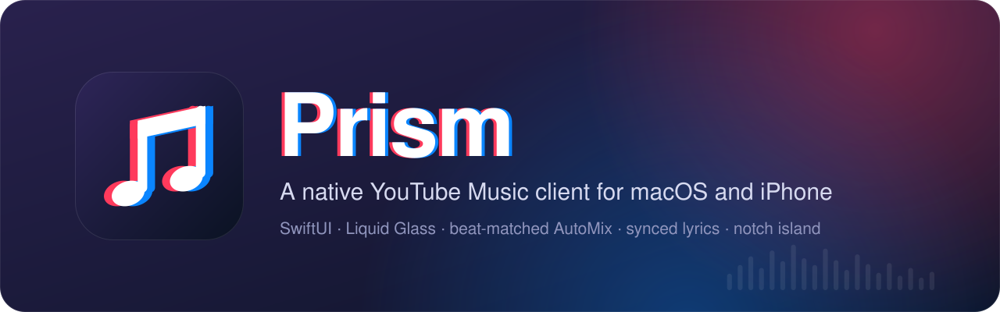
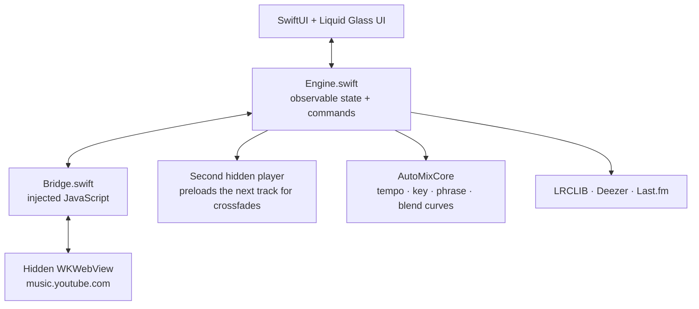

<p align="center">
  
</p>

<p align="center">
  
  
  
  
  
</p>

**Prism** is a native YouTube Music client for macOS and iPhone, written in SwiftUI with Apple's Liquid Glass design.

It is not a browser wrapper with a skin on it. Prism runs the real `music.youtube.com` in a webview you never see and drives it from a native app through an injected JavaScript bridge. Your account, your library and Premium playback all come from the real service, so there is no stream-extraction hack to break when YouTube changes something.

On top of that it adds things YouTube Music doesn't have: DJ-style **beat-matched transitions**, synced **lyrics**, a **notch island** on MacBooks, a full-screen **ambient mode**, and year-round **listening stats**.

---

## Highlights

- **AutoMix: transitions that line up on the beat.** Prism works out the blend length as a musical phrase from both tracks' tempos, then bends the two songs toward a shared tempo so their beats overlap. The maths lives in its own pure-Swift library, [`AutoMixCore`](Sources/AutoMixCore), with its own test suite.
- **Engineered around measured limits.** Testing showed that every playback-rate change freezes YouTube's media clock for 350–500 ms. So AutoMix doesn't glide the tempo continuously. It places two or three small rate changes in the stretch of the mix where the outgoing song is 10–21 dB down and the listener can't hear them.
- **One codebase, two platforms.** The engine, bridge, queue logic, stats, search ranking and AutoMix are the same files on macOS and iOS. Only the layout is rebuilt for the phone (sidebar → tab bar, side queue → sheet).
- **No Xcode project.** Both apps are compiled with SwiftPM / `swiftc` and the app bundles are assembled by shell scripts, so the build is fully reproducible from the command line.
- **Documented like an engineering project.** [`docs/engineering-notes.md`](docs/engineering-notes.md) records every design decision and dead end. [`docs/macos-inventory.md`](docs/macos-inventory.md) indexes 82 features and the 88 bugs and hard limits found building them.

## Features

| | |
| --- | --- |
| **Playback & queue** | Full transport, live queue with drag-to-reorder, play next, shuffle and clear. Playing any song starts a radio so the queue never runs dry. |
| **Transitions** | Crossfades up to 30 seconds through a second hidden player, plus AutoMix beat-matching and a switch-style mix that cuts in on the drop. |
| **Lyrics** | Synced lyrics that follow playback, from LRCLIB (per-word when available) or YouTube Music's Musixmatch lyrics. Click a line to jump to it. |
| **Notch island** | On a notched MacBook, cover art and live waves sit beside the notch. Hover to drop down a mini player; swipe for a utility face with the time and AirDrop. |
| **Ambient & locked mode** | A full-screen surface with cover art, lyrics and a glowing rim that reacts to the music and hands its colours to the next song. |
| **Listening stats** | Hours, plays, streaks, top artists and tracks across 7 days to all time. Import your full history from Google Takeout and scrobble to Last.fm. |
| **Search & library** | Filtered search re-ranked against your own listening, your playlists and albums, quick playlists, and multi-select (Shift/Cmd-click) to add songs to playlists. |
| **Audio routing** | Pick any output from the sidebar, or play on several outputs at once. |
| **System integration** | Media keys, Control Center and Now Playing with correct artwork. |
| **Look & feel** | Album-art colour extraction drives the backdrop and equalizers, plus compact mode and a music-video mode that plays the video behind the glass UI. |

## How it works



The webview stays mounted at full size behind an opaque backdrop, because WebKit throttles media in hidden or zero-sized views. Everything you see is native SwiftUI; everything you hear comes from YouTube's own player.

## Build and run

Requires **macOS 26+** and the **Xcode Command Line Tools**. No Xcode, Node or Homebrew needed.

```bash
./build.sh && open Prism.app      # macOS app
./build-ios.sh --run              # iPhone 16 Pro simulator
swift run AutoMixTests            # AutoMix test suite (exits non-zero on failure)
```

Launch with `open`, not by running the binary directly; a process started from a shell never connects to the window server. On first launch, click **Sign in** in the sidebar and log into your Google account once.

## Project layout

```
Sources/
├── AutoMixCore/    Pure algorithms, no UI or WebKit: tempo, beat tracking, musical key,
│                   phrase length, blend curves, tempo ramps, spectrum metering
├── AutoMixTests/   Standalone test runner for AutoMixCore
├── Prism/          The app, shared by macOS and iOS (engine, bridge, UI, stats, lyrics)
└── PrismIOS/       The iPhone shell: tab bar, sheets, AirPlay picker
docs/
├── engineering-notes.md   The full build journal
└── macos-inventory.md     Feature and bug inventory written before the iOS port
build.sh            Builds and signs Prism.app
build-ios.sh        Builds the iOS simulator app
```

## Status and known limits

Prism is a personal project in active development, verified against a signed-in YouTube Music Premium account. Honest limits:

- **Crossfade is macOS-only.** WebKit on iOS silently ignores volume changes once media is playing, so a fade would play both songs at full volume and then cut. Rather than sound broken, it is switched off on iPhone and the app says why.
- **Tempo data is sparse.** BPM comes from Deezer's public API, which reports `bpm: 0` for much of its catalogue. When tempos are unknown, AutoMix still eases into the mix but doesn't claim the beats will line up.
- **Downloads are requests, not files.** Prism asks YouTube Premium to save a song offline; YouTube sends no confirmation, so the UI says "requested", not "downloaded".

See the [engineering notes](docs/engineering-notes.md) for the full list and the reasoning behind each one.

## Disclaimer

Prism is an independent personal project. It is not affiliated with, endorsed by, or sponsored by YouTube or Google. It requires your own YouTube Music account, and all playback happens in YouTube's own web player.

---

<p align="center">Built by <a href="https://github.com/VIPPYJose">Jose Gerald</a></p>
